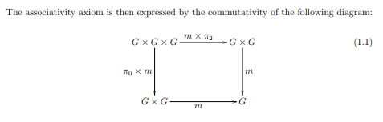

I claim it is interesting to work with a forest of terms as a primary object of consideration rather than a single tree term.

When I speak of trees (spanning tree, union find is a tree, etc), I often meant forest (or dag). I have learned to try and catch myself on this .

(but also who cares. C'mon you know what I mean. Let's not be pedantic asses. On the other hand sometimes you _don't_ know what I mean, and sometimes _I_ don't know what I mean, so maybe we _should_ be pedantic asses?).

Because a forest term has multiple inputs and multiple outputs, it matches category theory better / there is a natural notion of composition. Traditionally can look at this as composition of substitutions, but I like the concept of "Forest Term" as being on the same conceptual level as the idea of "AC terms" or "Keyword Arg Terms" or "Polynomial Terms" or "Strings" or what have you. All are kind of intuitive structural variations on the concept of term that make some things easier or harder and that bake in some structure you might try to encode in boring old standard terms.

I wrote more about this here <https://www.philipzucker.com/categorical_multiterms/>

Here's a question: Anything we do with terms, what does it look like to do with forest terms?

- Hash Consing
- Equational Logic Kernels
- Unification
- Rewriting
- Knuth Bendix

Today I wanted to explore an equational logic kernel, because it looks like Lawvere theory <https://ncatlab.org/nlab/show/Lawvere+theory> , the categorical perspective on simple equational reasoning.

# Basic Terms and Equational Logic Proof Kernel

First though, let's look at what an equational logic kernel looks like on boring terms.

This is a basic term datatype

```python
from dataclasses import dataclass
class Term: ...
@dataclass(frozen=True)
class App(Term):
    f : str
    args : tuple[Term,...]
    def subst(self, n, t):
        return App(self.f, tuple(a.subst(n,t) for a in self.args))
@dataclass(frozen=True)
class Var(Term):
    n : int
    def subst(self, n, t):
        return t if n == self.n else self

t = App("f", (Var(0), App("a", ())))
assert t.subst(0, App("a", ())) == App("f", (App("a", ()), App("a", ())))

```

We can encode the equality judgement as a protected datatype that is only constructed through smart constructors that correspond to each of the inference rules. The data that comes into these constructors is the stuff above the horizontal line in inference rules and it produces a thing that represents the thing under the inference line. This is the "LCF" style.

```
arg1     arg2     arg3
------------------------- my_smart_constructor
        Proof(something)
```

Python does not offer strong data protection, but hopefully you get the gist. The point is to catch honest mistakes, not adversarial ones. It gives us something to do.

```python
from typing import Self
@dataclass(frozen=True)
class Proof:
    lhs : Term
    rhs : Term
    @staticmethod
    def refl(t : Term):
        assert isinstance(t, Term)
        return Proof(t,t)
    @staticmethod
    def axiom(lhs : Term, rhs : Term) -> Self:
        return Proof(lhs,rhs)
    @staticmethod
    def cong(f : str, *args : Self) -> Self:
        assert all(isinstance(a, Proof) for a in args)
        return Proof(App(f, tuple(a.lhs for a in args)), App(f, tuple(a.rhs for a in args)))
    def trans(pf1 : Self, pf2 : Self) -> Self:
        if pf1.rhs != pf2.lhs:
            raise ValueError(pf1.rhs, pf2.lhs)
        return Proof(pf1.lhs, pf2.rhs)
    def symm(self : Self):
        return Proof(self.rhs, self.lhs)
    def subst(self : Self, n : int, t : Term):
        return Proof(self.lhs.subst(n,t), self.rhs.subst(n,t))

v0,v1,v2 = [Var(n) for n in range(3)]
a = App("a", ())
b = App("b", ())
c = App("c", ())
ab = Proof.axiom(a,b)
bc = Proof.axiom(b,c)


aa = Proof.refl(a)
assert Proof.symm(aa) == aa
assert Proof.trans(aa,aa) == aa
assert Proof.trans(aa, ab) == ab
assert Proof.trans(ab,bc).rhs == c
Proof.cong("f", ab, Proof.refl(c))

```

    Proof(lhs=App(f='f', args=(App(f='a', args=()), App(f='c', args=()))), rhs=App(f='f', args=(App(f='b', args=()), App(f='c', args=()))))

Here we can define some group theory axioms and use them

```python
inv = lambda x: App("inv", (x,))
mul = lambda x,y : App("mul", (x,y))
e = App("e", ())

inv_left = Proof.axiom(mul(inv(v0), v0), e)
id_right = Proof.axiom(mul(v0, e), v0)

# Prove
# inv(e) = e
id_right.subst(0,inv(e)).symm().trans(inv_left.subst(0,e))
# pretty confusing to do by hand

```

    Proof(lhs=App(f='inv', args=(App(f='e', args=()),)), rhs=App(f='e', args=()))

# Forest Terms

One thing people say is that a Lawvere theory is the categorical version of equational logic. If so, a proof kernel using forest terms ought to look like Lawvere theory.

It is at least an interesting idea to state how many variables a term can have in it. This is a notion of context. A _minimal_ context can be inferred by traversing the term, but this convention fails to allow you to state that a term is in a larger context that necessary. Tracking the context like this leads to semantic models that I prefer. This context is also directly the domain of the forest term considered as a morphism. This more meaningfully allows you to represent the concept of a projection, because projections don't use all the variables they could.

The number of terms in the forest is the codomain. Substitution is plugging.

I found the pretty printer kind of a useful thing to show how these forest terms correspond to categorical expressions. An `App` node represents a composition with a primitive and a usage of product. `App(f, [arg0,arg1]) ~ f . <arg0, arg1>`. This is right associated composition. An App node is to a Comp node in a somewhat similar way a Cons node is related to a Append node for lists. It is kind of nice sometimes (and kind of sucks sometimes) to normalize out the associativity.

I said before that category theory emphasizes the argument list. `TermSeq` is on it's own semantically meaningful as the cartesian product of the morpisms inside of it. That is another reason to give the type a name rather than make it an anonymous `tuple[Term,...]`

```python
from dataclasses import dataclass

class Term: ...
@dataclass(frozen=True)
class TermSeq:
    ctx : int
    terms : tuple[Term, ...]
    def __post_init__(self):
        assert self.ctx >= 0
        assert all(isinstance(t, Term) for t in self.terms)
        assert isinstance(self.terms, tuple)
    def __matmul__(self, other): # subst analog. Compose .
        assert self.ctx == len(other.terms)
        return TermSeq(other.ctx, tuple(a.subst(other) for a in self.terms))
    def __mul__(self, other): # pair <f,g>. They have the some domain. Share input wires
        assert self.ctx == other.ctx
        return TermSeq(self.ctx, self.terms + other.terms)
    def kron(self, other): # otimes / the monoidal product. Distinct input wires
        return TermSeq(self.ctx + other.ctx, tuple([t.extend(other.ctx) for t in self.terms] +
                                                   [t.shift(other.ctx, self.ctx) for t in other.terms]))
    @staticmethod
    def id_(n : int):
        return TermSeq(n, tuple(Var(i) for i in range(n)))
    @staticmethod
    def delete(n : int):
        return TermSeq(n, ())
    @staticmethod
    def symbol(f : str, arity : int):
        return TermSeq(arity, (App(f, TermSeq.id_(arity)),))
    @staticmethod
    def proj(n : int, i : int):
        return TermSeq(n, (Var(i),))
    @staticmethod
    def perm(p : list[int]):
        assert sorted(p) == list(range(len(p)))
        return TermSeq(len(p), tuple(Var(image) for image in p))
    def __str__(self):
        if len(self.terms) == 0 and self.ctx == 0:
            return "id0"
        elif len(self.terms) == 0:
            return f"del_{self.ctx}"
        elif len(self.terms) == 1:
            return str(self.terms[0])
        else:
            return f"<{", ".join(map(str,self.terms))}>"
@dataclass(frozen=True)
class App(Term):
    f : str
    args : TermSeq
    def subst(self, s : TermSeq):
        return App(self.f, TermSeq(s.ctx, tuple(a.subst(s) for a in self.args.terms)))
    def shift(self, ctx : int, n :int):
        return App(self.f, TermSeq(ctx + n, tuple(a.shift(ctx,n) for a in self.args.terms)))
    def extend(self, n : int):
        return App(self.f, TermSeq(self.args.ctx + n, tuple(a.extend(n) for a in self.args.terms)))
    def __str__(self):
        return f"{self.f} . {str(self.args)}"
@dataclass(frozen=True)
class Var(Term):
    n : int
    def subst(self, s : TermSeq):
        assert 0 <= self.n < len(s.terms)
        return s.terms[self.n]
    def shift(self, ctx, n : int): # add identity on the left
        return Var(self.n+n)
    def extend(self, n : int): # add identify on the right
        return Var(self.n)
    def __str__(self):
        return "prj" + str(self.n)


```

Here's an example term. In a named representation, this could be written as `x,y,z |-> x,z`

```python
str(TermSeq(3, (Var(0), Var(2)))) # x,y,z |-> x,z
```

    '<prj0, prj2>'

Some more manipulations of a constant `a` and permutations and a 3-arity function symbol `f`

```python
f = TermSeq.symbol("f", 3) # x,y,z |-> f(x,y,z)
p = TermSeq.perm([0,2,1])  # x,y,z |-> x,z,y
fp = f @ p  # x,y,z |-> f(x,z,y)
print(fp) 
```

    f . <prj0, prj2, prj1>

```python
a = TermSeq(0, (App("a", TermSeq.id_(0)),))  # |-> a 
print(a)
```

    a . id0

```python
print(f @ (a * a * a))  #  |-> f(a,a,a)
```

    f . <a . id0, a . id0, a . id0>

```python
str(fp @ (a * a).kron(TermSeq.id_(1))) # x |-> f(a,x,a)
```

    'f . <a . del_1, prj0, a . del_1>'

# Equational Proofs for Forest Terms

Once we're using Forest Terms, Proof becomes rather pretty. There are two notions of composition, equational transitivity `a =b /\ b = c -> a = c` and playing nice with composition `f = g /\ h = k -> f . h = g . k`. "Playing nice with composition" includes both the congruence and substitution rule of the earlier version.

Because of the forestiness, the equality judgement is extended to a multiequation. This also feels right. There is an intuition that mutliequations (a conjunction of equations) is the better thing to work with because unification is way more naturally stated in this form. It is again a merely structural sort of organizational thing to do because we already have conjunctions in equational logic in the sense of having multiple proof trees.

Indeed this structure is more naturally a _Proof Forest_ rather than a Proof Tree. This extra flexibility makes some things more cleanly stateable (like partial constructions).

I will admit it is anti-elegant in the sense it just looks like more code than the simple term version. But I think this is sort of the draw too? It's hard to discover there's something nice here past the local minimum just from a pure programming perspective.

```python
@dataclass
class Proof:
    lhs : TermSeq
    rhs : TermSeq
    @staticmethod
    def refl(t : TermSeq) -> Self: # identity
        return Proof(t,t)
    def hcomp(self, other): # subst and cong. functorial on compose
        return Proof(self.lhs @ other.lhs, self.rhs @ other.rhs)
    def vcomp(self, other): # transitivity
        assert self.rhs == other.lhs
        return Proof(self.lhs, other.rhs)
    def symm(self):
        return Proof(self.rhs, self.lhs)
    def __mul__(self, other): # homomorphic on pair. This is kind of the other piece of cong.
        return Proof(self.lhs * other.lhs, self.rhs * other.rhs)
    @staticmethod
    def axiom(lhs : TermSeq, rhs : TermSeq) -> Self:
        assert lhs.ctx == rhs.ctx and len(lhs.terms) == len(rhs.terms)
        return Proof(lhs, rhs)
    def __str__(self):
        return f"|- {self.lhs} = {self.rhs}"
    
```

Axioms of a monoid



( Hmm actually is this diagram wrong? It should be identity arrows, not projections?
<https://ncatlab.org/nlab/show/group+object> These diagrams might be better. )

```python
mul = TermSeq.symbol("mul", 2)
inv = TermSeq.symbol("inv", 1)
e = TermSeq.symbol("e", 0)
id = TermSeq.id_(1)
assoc = Proof.axiom( mul @ (mul.kron(id)), 
                     mul @ (id.kron(mul))) 
str(assoc)

```

    '|- mul . <mul . <prj0, prj1>, prj2> = mul . <prj0, mul . <prj1, prj2>>'

```python
id_left = Proof.axiom( mul @ e.kron(id), id)
str(id_left)
```

    '|- mul . <e . del_1, prj0> = prj0'

```python
id_right = Proof.axiom(mul @ id.kron(e), id)
inv_left = Proof.axiom(mul @ (inv * id), e @ TermSeq.delete(1))

pf = (
    id_right.hcomp(Proof.refl(inv @ e)).symm()
    .vcomp(inv_left.hcomp(Proof.refl(e)))
)

assert pf.lhs == inv @ e and pf.rhs == e
print(pf)  # |- inv(e) = e
```

    |- inv . e . id0 = e . id0

# Bits and Bobbles

It kind of sucks that I print var(n) as projn when really it should be proj_d_n. Maybe App and Var should have a ctx field also to make them semantically meaningful

Extend and shift could be perhaps be generalized by a framing vector `list[bool]` that is the analog of a thinning. This tells you how many identity morphisms to slap on the side of the interesting thing.

Thinnings would also be an interesting TermSeq constructor
```python
@staticmethod
def thin(t : list[bool]):
    return TermSeq(len(t), [Var(i) for i,take in enumerate(t) if take])
```

I should've drawn some pictures. Obviously I'm visualizing string diagrams when I talk about some of these things. `f * g` is a fork of inputs. `f.kron(g)` is setting them side by side.

<https://awodey.github.io/typetheory/notes/catlog2024.pdf> bauer awodey introduction to categorical logic chapter 1

<https://link.springer.com/chapter/10.1007/3-540-18508-9_23> Foundations of equational deduction: A categorical treatment of equational proofs and unification algorithms. Can't find a copy, but sounds good.

Forest terms are kind of interesting for unification under a mixed prefix. We can mark some vars as flexible and some as rigid. Rigids can only be thinned, but flexible can be substituted for. This forms a subcategory of substitutions.

One way of looking at forest terms is as a normal form of categorical expressions. `App` is a fused version of compose and pair such that it is right associated. This is akin to how `Cons` cells are a normal form of fully right associated `Append/Concat`.

```
App(f, [t0,t1,t2]) ~  f . <t0, t1, t2>
```

Linear usage of variables is kind of interesting. By removing cartesian product, forest terms are no longer equivalent to a bunch of regular terms, nor os forest term equational logic. There isn't really a classical vs intuitionistic in equational logic. But there is a concept of substructural equational logic I think. I wonder if there is a way to egraphify this? This may have something to do with operads and linear variable usage in rewrite rules.

If we remove pair, the normal form above is not available. We could still try to right associate, but would want to use the tensor product which doesn't reuse the same variables instead of pair. We could try to float horizontally independent layers as high as possible  `App([f,g,h], subdiagram) ~ kron(f,g,h) . subdiagram`. This is kind of Foata normal form

```
kron(f,g) . kron(h,k) =  kron(f . h, g. k) but ONLY if the dimensions line up
```

Term orderings of forest terms seems intriguing. It is somewhat natural to use the interpretation method to map them into some other category, like affine transformations (matrices + offset of ground terms) of paths. I find this to be a kind of cute idea to use this to convert string orderings into a term ordering by considering multisets of paths where multiplication is concatentation and addition is multiset addition. This is a semiring interpretation

I have been told that Proof above is a (2,1) category. <https://ncatlab.org/nlab/show/(2,1)-category>

Cody was talking about the monad connection but maybe my formulation where my objects are structures nats won't support that. I might need to do the same thing but with a richer python dict FinSet.

```
class TermDict:
    dom : set[object]
    data : dict[object,Term]
    def 

```

An idea that might be interesting is to add a initial object to represent failure rather than have equalizer just being a partial operation.

Actually do the unification algorithm

equalizer rules

```
              ---f --->
eq(f,g) ---> 
              ---g --->


```

```
eq(f . g, f . h) = eq(g,h) if f monic/injective. The rule that strips off an f in unification
eq(<f,g>,<h,k>) = <eq(f,g),eq(h,k)> . breaking up the argument list into multiple equations

```

Every "exists unique" is nicely thought of as defining some kind of function. `eq(f,g)`, `<f,g>`

Mcbride's thesis

working in an ambient context. slice category?

Coalgebra makes more sense from this perspective.

`TermSeq(1, [hd(Var(0)), tl(Var(0))])`

first class hole ands refinement egraphs.
First class holes does not require us to move even into type logic to get started

So Telescopes seems like a different axis?

Thining as (are?) a subcatgoery of substututions

TermSeq(3, [Var(0), Var(2)]) is a thinning

Mixed prefix / first class holes are a different subcategory with dependency restrictions
Rigids can only be thinned, not substituted
refinement = exists metasubst, t = metasubst . s  . Factorization
metasubst have to leave rigids alone. It's a subcategory. meta subsituttion and object substitution
Mixed Quantifier Equational Logic. forall x, exists z, forall y, t = s  instead of forall vs, t = s.
unityped, simply typed, dependently typed.
From a backwards search perspective, exists are metavars and forall is rigid.
from forward, exists are rigid, forall is meta.

Martin lof had a substitution calculus. Dybjer <https://arxiv.org/abs/1904.00827> castellan Clairambault,
Mcbride said in thesis john major equality is for comparing equality of subsitutions?

forest cyclic terms. Some variables are empty and some aren't. Calgerba? Fix operatro -> iteration theory
Rational terms. traced monoidal categgory? <https://en.wikipedia.org/wiki/Traced_monoidal_category>
TermSeq(vars=[None, None, App("f", [32,43]), ...], roots = [43,42,67]
TermSeq(vars=[0,5,64], arena=[None | App], roots = [23,5])
Is identifying cyclic term vars and free vars a good idea? Might be a good reason to keep them seaprate.
I considered lifted terms + unification to be sensible. Object vs meta variables

Lawvere theory = equational logic lcf using multiterms. Knuth bendix? Multiterm rewrite rules?

A 2 category. transitivty is 2 composition. a 2 groupoid
interchange law is not on the nose
polycategories

Term Orderings?
Interpreation orders. Term orderings seem assymmetric wrt composition?
Matrix interpretation of TermSeq. Entries could be path polynomials (non commucative semiring)?
Unary RPO vs len lex vs lex  for string ordering -->  

Refinement Orderings?

```python
from daatclasses import dataclas
@dataclass
class Proof:
    lhs : TermSeq
    rhs : TermSeq
    reasons : list[object]


    def __matmul__(self, other):
        if not isinstance(other, Proof):
            raise TypeError("Operand must be a Proof instance")
        return Proof(self.lhs @ other.lhs, self.rhs @ other.rhs, reasons=["comp", self, other])
    def __add__(self, other): ...
    def __mul__(self, other): ...
    @staticmethod
    def id_(t: TermSeq): # hmm. id takes a term. Not the identity subvsitution
        if not isinstance(t, TermSeq):
            raise TypeError("Argument must be a TermSeq instance")
        return Proof(t, t, reasons=["refl"])
    def hcomp(self, other : Self):  # transitivity hcomp
        if not isinstance(other, Proof):
            raise TypeError("Operand must be a Proof instance")
        if self.rhs != other.lhs:
            raise ValueError("Incompatible proofs for composition")
        return Proof(self.lhs, other.rhs, reasons=["comp", self, other])
    def symm(self):
        if not isinstance(self, Proof):
            raise TypeError("Operand must be a Proof instance")
        return Proof(self.rhs, self.lhs, reasons=["symm", self])


# id
def refl(t):
    Proof(t,t,reasons=["refl"])

# @, *, + also work on proofs

# instead of precomp use refl + @
def precomp(p : Proof, t : TermSeq): # subst
    Proof(t @ p.lhs, t @ p.rhs, reasons=["precomp", p])
def postcomp(p : Proof, t : TermSeq): # cong
    Proof(p.lhs @ t, p.rhs @ t, reasons=["postcomp", p])
#def pair(p1 : Proof, p2 : Proof):
#    Proof(p1.lhs @ p2.lhs, p1.rhs @ p2.rhs, reasons=["pair", p1, p2])


```

```python
from dataclasses import dataclass,field
class Term:...
@dataclass
class TermSeq:
    ctx : list[int] # alternating list of rigid / unify contexts
    terms : list[Term]
@dataclass
class App:
    f : str
    args : TermSeq
@dataclass
class Var:
    index : int # could refer to sum position or tuple[int,int] position? tuple[int,int] is more stable
```

Telescoped style vs assumptions style. vars |- assumes |- terms  vs interleaved carefully

Composition merges assumes. Set wise?

vars |- (assumes, terms) ?

```python

from dataclasses import dataclass,field
class Term:...
@dataclass
class TermSeq:
    ctx : int
    assumes : list[Term] #
    terms : list[Term]
@dataclass
class App:
    f : str
    args : TermSeq
@dataclass
class Var:
    index : int # could refer to sum position or tuple[int,int] position? tuple[int,int] is more stable
```

```python
from dataclasses import dataclass,field
class Term:...
@dataclass
class TermSeq:
    ctx : list[type]
    terms : list[Term]
@dataclass
class App:
    f : str
    args : TermSeq
@dataclass
class Var:
    index : int


```

```python
from dataclasses import dataclass,field
class Term:...
@dataclass
class TermSeq:
    ctx : list[list[Term]] #? stack of telescopes rigid / unify alternating
    terms : list[Term]

@dataclass
class App:
    f : str
    args : TermSeq
@dataclass
class Var:
    index : int
```
